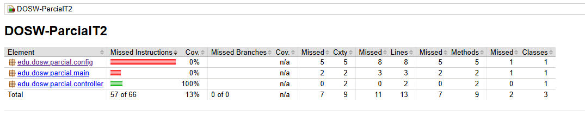
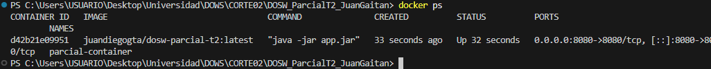
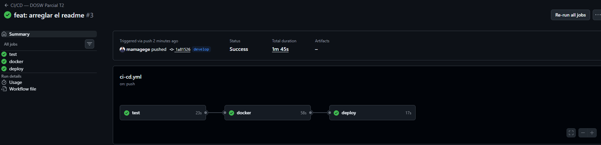
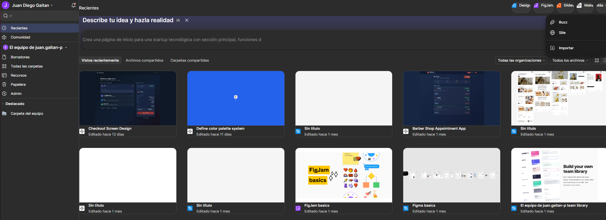

# DOSW_ParcialT2_JuanGaitan — Bob's Barbery Backend

## Índice de Contenidos
1. [Datos del Estudiante](#1-datos-del-estudiante)
2. [Descripción General del Proyecto](#2-descripción-general-del-proyecto)
3. [Despliegue en Microsoft Azure](#3-despliegue-en-microsoft-azure)
4. [Estructura del Proyecto y Arquitectura MVC](#4-estructura-del-proyecto-y-arquitectura-mvc)
5. [Tecnologías y Dependencias](#5-tecnologías-y-dependencias)
6. [Configuración y Variables de Entorno](#6-configuración-y-variables-de-entorno)
7. [Cómo Ejecutar el Proyecto](#7-cómo-ejecutar-el-proyecto)
8. [Pruebas Automatizadas y Aseguramiento de Calidad](#8-pruebas-automatizadas-y-aseguramiento-de-calidad)
9. [Docker y Docker Compose](#9-docker-y-docker-compose)
10. [Pipeline de Integración y Despliegue Continuo (CI/CD)](#10-pipeline-de-integración-y-despliegue-continuo-cicd)
11. [Herramientas de Modelado y Diseño (Evidencias)](#11-herramientas-de-modelado-y-diseño-evidencias)
12. [Patrones de Diseño y Principios SOLID](#12-patrones-de-diseño-y-principios-solid)
13. [Documentación Técnica Detallada (Directorio `docs/`)](#13-documentación-técnica-detallada-directorio-docs)

---

## 1. Datos del Estudiante
- **Nombre completo:** Juan Diego Gaitán Pérez
- **Asignatura:** Desarrollo y Operaciones de Software (DOSW / DOWS)
- **Grupo:** 1
- **Periodo Académico:** 2026-01
- **Institución:** Escuela Colombiana de Ingeniería Julio Garavito
- **Profesor agregado al repositorio:** Sí
- **Enlace Bitácora:** [https://github.com/mamagege/BitacoraDOWS.git](https://github.com/mamagege/BitacoraDOWS.git)

---

## 2. Descripción General del Proyecto
**Bob's Barbery Backend** es una solución RESTful desacoplada, escalable y observable desarrollada sobre **Java 21**, **Spring Boot 3.2.4** y **Spring Data MongoDB**, que constituye la evolución completa del Tercio 1 para el **Parcial Práctico del Segundo Tercio**.

El sistema moderniza la gestión de turnos de una barbería mediante:
- **Validación Encadenada Secuencial (Chain of Responsibility):** 5 etapas de validación obligatorias (aforo de franja horaria máx. 3 clientes, disponibilidad y asignación automática de barbero por especialidad, validación estricta de cliente, catálogo activo y verificación de pasarela).
- **Normalización Multicanal de Pagos (Patrón Adapter):** Integración homogénea de pasarelas heterogéneas (Nequi, PSE bancario, Stripe y Efectivo en caja) retornando un contrato interno único `{ paymentId, status, message }`.
- **Persistencia No Relacional:** Almacenamiento en clúster MongoDB de documentos atómicos para citas (`turnos`), usuarios (`usuarios`), servicios (`servicios`) y barberos (`barberos`).
- **Seguridad Perimetral Stateless:** Autenticación y autorización basada en **Spring Security** y tokens **JWT (JJWT 0.12+)** con cifrado HMAC-SHA256 y hashing de contraseñas con **BCrypt**.
- **Infraestructura de Contenedores y DevOps:** Empaquetado multietapa con **Docker**, orquestación local con **Docker Compose**, pipeline de CI/CD automatizado con **GitHub Actions** y despliegue continuo en **Azure App Service**.

---

## 3. Despliegue en Microsoft Azure
El backend se encuentra configurado y desplegado de forma continua en **Azure App Service para Contenedores Linux**:

- **URL Base del Servicio:**  
  [https://dows-parcial-t2-bmhrbwbzdsafe8cm.eastus-01.azurewebsites.net](https://dows-parcial-t2-bmhrbwbzdsafe8cm.eastus-01.azurewebsites.net)
- **Endpoint de Salud (Health Check):**  
  [https://dows-parcial-t2-bmhrbwbzdsafe8cm.eastus-01.azurewebsites.net/api/v1/health](https://dows-parcial-t2-bmhrbwbzdsafe8cm.eastus-01.azurewebsites.net/api/v1/health)
- **Documentación Interactiva Swagger UI:**  
  [https://dows-parcial-t2-bmhrbwbzdsafe8cm.eastus-01.azurewebsites.net/swagger-ui/index.html](https://dows-parcial-t2-bmhrbwbzdsafe8cm.eastus-01.azurewebsites.net/swagger-ui/index.html)
- **Especificación OpenAPI (JSON):**  
  [https://dows-parcial-t2-bmhrbwbzdsafe8cm.eastus-01.azurewebsites.net/v3/api-docs](https://dows-parcial-t2-bmhrbwbzdsafe8cm.eastus-01.azurewebsites.net/v3/api-docs)

---

## 4. Estructura del Proyecto y Arquitectura MVC

El proyecto sigue estrictamente el modelo arquitectónico por capas desacoplado exigido en el laboratorio:

```text
DOSW_ParcialT2_JuanGaitan/
├── docs/                                     # Documentación técnica y evidencias
│   ├── 01-contexto-y-alcance.md
│   ├── 02-analisis-de-requerimientos.md
│   ├── 03-arquitectura-y-MVC.md
│   ├── 04-modelo-de-datos-MongoDB.md
│   ├── 05-api-rest-y-endpoints.md
│   ├── 06-seguridad-JWT.md
│   ├── 07-pruebas-y-calidad.md
│   ├── 08-docker-y-docker-compose.md
│   ├── 09-cicd.md
│   ├── 10-despliegue-en-Azure.md
│   ├── 11-SOLID-y-patrones.md
│   ├── 12-trazabilidad-de-requisitos.md
│   ├── 13-guia-de-reproduccion.md
│   ├── uml/                                  # Diagramas fuente del sistema
│   └── images/                               # Capturas de evidencia requeridas
│
├── src/
│   ├── main/
│   │   ├── java/edu/dosw/parcial/
│   │   │   ├── controller/                   # PRESENTACIÓN: Controladores REST
│   │   │   │   ├── dtos/
│   │   │   │   │   ├── request/              # CreateTurnoRequest, LoginRequest, RegisterRequest
│   │   │   │   │   └── response/             # TurnoResponse, AuthResponse, ErrorResponse, etc.
│   │   │   │   ├── mappers/                  # MAPPER IN: RequestDTO -> Dominio, Dominio -> ResponseDTO
│   │   │   │   ├── handlers/                 # GlobalExceptionHandler (@RestControllerAdvice)
│   │   │   │   ├── TurnoController.java
│   │   │   │   ├── AuthController.java
│   │   │   │   ├── CatalogController.java
│   │   │   │   └── HealthController.java
│   │   │   │
│   │   │   ├── core/                         # DOMINIO Y LÓGICA DE NEGOCIO
│   │   │   │   ├── models/                   # Cliente, Servicio, Barbero, Turno, Usuario, PagoResultado
│   │   │   │   ├── services/                 # TurnoService, AuthService, CatalogService, ServiceCatalog, BarberRegistry
│   │   │   │   │   └── adapters/             # PATRÓN ADAPTER: InterfacePaymentMethod, NequiAdapter, PseAdapter, StripeAdapter, EfectivoAdapter, PaymentAdapterFactory
│   │   │   │   ├── validators/               # PATRÓN CHAIN OF RESPONSIBILITY: ValidationHandler, TimeAvailableHandler, BarberAvailableHandler, ClientValidationHandler, CatalogValidationHandler, PaymentValidationHandler, ValidationChainFactory
│   │   │   │   └── utils/                    # TimeSlotUtil
│   │   │   │
│   │   │   ├── persistence/                  # PERSISTENCIA (MONGODB)
│   │   │   │   ├── entities/                 # TurnoDocument, UserDocument, ServiceDocument, BarberDocument
│   │   │   │   ├── repositories/             # TurnoRepository, UserRepository, ServiceDocumentRepository, BarberDocumentRepository
│   │   │   │   └── mappers/                  # MAPPER OUT: Dominio <-> Document (MongoDB)
│   │   │   │
│   │   │   ├── config/                       # INFRAESTRUCTURA Y SEGURIDAD
│   │   │   │   ├── SecurityConfig.java       # Spring Security stateless + BCrypt
│   │   │   │   ├── JwtService.java           # Firma y validación JJWT HS256
│   │   │   │   ├── JwtAuthenticationFilter.java # Filtro Bearer Authorization
│   │   │   │   ├── CustomUserDetailsService.java# Adaptador de credenciales de MongoDB
│   │   │   │   ├── SwaggerConfig.java        # OpenAPI 3.0 con SecurityScheme Bearer
│   │   │   │   └── DataInitializer.java      # Sembrado inicial de datos en MongoDB
│   │   │   │
│   │   │   └── main/                         # PUNTO DE ENTRADA
│   │   │       └── ParcialApplication.java   # @SpringBootApplication(scanBasePackages = "edu.dosw.parcial")
│   │   │
│   │   └── resources/
│   │       └── application.yaml              # Configuración centralizada de perfiles
│   │
│   └── test/
│       ├── java/edu/dosw/parcial/            # 28 PRUEBAS UNITARIAS Y DE INTEGRACIÓN
│       │   ├── config/JwtServiceTest.java
│       │   ├── controller/AuthControllerTest.java, CatalogControllerTest.java, HealthControllerTest.java, TurnoControllerTest.java
│       │   ├── core/services/TurnoServiceTest.java, adapters/PaymentAdaptersTest.java
│       │   ├── core/validators/ValidationHandlersTest.java
│       │   └── persistence/EntityMappersTest.java
│       └── resources/application.yaml
│
├── Dockerfile                                # Construcción multietapa (Maven Temurin 21 -> Alpine JRE 21)
├── compose.yaml                              # Orquestación Docker Compose (Spring Boot + MongoDB)
├── .env.example                              # Plantilla de variables de entorno seguras
├── .dockerignore
├── .gitignore
├── pom.xml                                   # Configuración de dependencias y plugins Maven
└── README.md
```

---

## 5. Tecnologías y Dependencias

| Tecnología / Dependencia | Versión | Propósito en el Proyecto |
| :--- | :--- | :--- |
| **Java Development Kit (JDK)** | 21 | Lenguaje de desarrollo y entorno base de ejecución moderno. |
| **Spring Boot** | 3.2.4 | Framework base para inyección de dependencias, autoconfiguración y microservicios. |
| **spring-boot-starter-web** | 3.2.4 | Servidor Tomcat embebido y arquitectura MVC para APIs REST. |
| **spring-boot-starter-data-mongodb** | 3.2.4 | Persistencia documental y repositorios sobre MongoDB. |
| **spring-boot-starter-validation** | 3.2.4 | Validación declarativa de DTOs (Jakarta Bean Validation). |
| **spring-boot-starter-security** | 3.2.4 | Seguridad perimetral, gestión de filtros HTTP y roles. |
| **JJWT (jjwt-api, impl, jackson)** | 0.12.3 | Generación, firmado simétrico HMAC-SHA256 y validación de tokens JWT. |
| **springdoc-openapi-starter-webmvc-ui** | 2.5.0 | Documentación OpenAPI 3.0 e interfaz gráfica interactiva Swagger UI. |
| **Project Lombok** | 1.18.30 | Eliminación de boilerplate (`@Data`, `@Builder`, `@RequiredArgsConstructor`, `@Slf4j`). |
| **JUnit 5 & Mockito** | 3.2.4 | Pruebas unitarias aisladas y pruebas de integración por capas. |
| **JaCoCo Plugin** | 0.8.12 | Generación de reportes de cobertura de código (`prepare-agent` y `report`). |
| **Docker Engine & Compose** | 24.x+ | Contenedorización multietapa y orquestación local con base de datos. |
| **Microsoft Azure** | Linux | Azure App Service (Web Apps for Containers) y clúster MongoDB. |

---

## 6. Configuración y Variables de Entorno

El sistema se parametriza mediante variables de entorno externas. **Ninguna credencial ni secreto se versiona en el repositorio:**

| Variable | Descripción | Valor por Defecto / Ejemplo |
| :--- | :--- | :--- |
| `PORT` | Puerto HTTP sobre el cual Tomcat escucha solicitudes. | `8080` |
| `MONGODB_URI` | Cadena de conexión al clúster MongoDB (local o en la nube). | `mongodb://localhost:27017/dosw_parcial` |
| `JWT_SECRET` | Llave simétrica en Base64 para firma de tokens (mínimo 256 bits). | `${JWT_SECRET:-404E6352665...}` |
| `JWT_EXPIRATION_MS` | Tiempo de vida del token en milisegundos. | `3600000` (1 hora) |
| `WEBSITES_PORT` | Enrutamiento de puertos en Azure App Service. | `8080` |

---

## 7. Cómo Ejecutar el Proyecto

### 7.1. Opción 1: Con Docker Compose (Entorno Completo Automatizado)
Levanta MongoDB y el backend Spring Boot interconectados en su propia red interna:

```bash
docker compose up -d --build
```
Verificar estado:
```bash
docker compose ps
docker compose logs -f app
```

---

### 7.2. Opción 2: Ejecución Local con Maven
1. Levantar instancia local de MongoDB:
   ```bash
   docker run -d --name mongo-parcial -p 27017:27017 -e MONGO_INITDB_DATABASE=dosw_parcial mongo:7
   ```
2. Ejecutar la aplicación:
   ```bash
   mvn spring-boot:run
   ```

---

## 8. Pruebas Automatizadas y Aseguramiento de Calidad

### 8.1. Ejecución de la Suite Completa de Pruebas
```bash
mvn clean test
```
Para ejecutar la verificación completa empaquetando el artefacto y generando el reporte JaCoCo:
```bash
mvn verify
```

- **Total de pruebas:** 28 pruebas ejecutadas
- **Fallos:** 0
- **Errores:** 0
- **Omitidas:** 0
- **Resultado:** `BUILD SUCCESS`

### 8.2. Evidencias de Pruebas y Cobertura

- **Ejecución de pruebas en verde:**
  

- **Reporte de cobertura JaCoCo:**
  

---

## 9. Docker y Docker Compose

### 9.1. Construcción y Ejecución de la Imagen Docker
- **Construcción multietapa:**
  ```bash
  docker build -t dosw-parcial:local .
  ```
- **Ejecución del contenedor:**
  ```bash
  docker run -d -p 8080:8080 --name dosw-parcial-app -e JWT_SECRET="404E635266556A586E3272357538782F413F4428472B4B6250645367566B5970" dosw-parcial:local
  ```

### 9.2. Evidencia de Ejecución en Docker

- **Contenedor en ejecución local:**
  

---

## 10. Pipeline de Integración y Despliegue Continuo (CI/CD)

El pipeline automatizado en `.github/workflows/ci-cd.yml` ejecuta tres fases continuas:
1. **`test`:** Clona el código, prepara JDK 21 Temurin y ejecuta `mvn verify` con pruebas y JaCoCo.
2. **`docker`:** Autentica en Docker Hub, construye la imagen multietapa y publica la etiqueta `:latest`.
3. **`deploy`:** Autentica en Microsoft Azure mediante un Service Principal (`AZURE_CREDENTIALS`) y despliega la imagen en Azure App Service.

### Evidencia del Pipeline en Verde:


---

## 11. Herramientas de Modelado y Diseño (Evidencias)

### 11.1. Cuenta y Espacio de Trabajo en Herramienta de Modelado (Lucidchart / Draw.io / Miro)


### 11.2. Cuenta y Espacio de Trabajo en Herramienta de Prototipado (Figma)


---

## 12. Patrones de Diseño y Principios SOLID

### Patrón 1: Chain of Responsibility (Comportamiento)
- **Problema que resuelve:** Encadena 5 validaciones obligatorias previas a la confirmación de la cita (aforo de franja, barbero disponible, datos de cliente, catálogo activo y cobro en pasarela).
- **Beneficio SOLID:** Cumple **SRP** (cada manejador valida exclusivamente un aspecto) y **OCP** (se pueden añadir nuevas validaciones sin alterar el flujo principal).

### Patrón 2: Adapter (Estructural)
- **Problema que resuelve:** Unifica las firmas heterogéneas de las pasarelas Nequi (`sendpayment`), PSE (`executeBankTransaction`), Stripe (`charge`) y Efectivo a una respuesta estandarizada `{ paymentId, status, message }`.
- **Beneficio SOLID:** Cumple **DIP** (el sistema depende de la interfaz `InterfacePaymentMethod` y no de SDKs bancarios concretos) y **OCP** (nuevas pasarelas se registran en `PaymentAdapterFactory` sin modificar el código de la barbería).

---

## 13. Documentación Técnica Detallada (Directorio `docs/`)

Para un análisis exhaustivo de cada área arquitectónica, consulte los documentos especializados:

1. [01 — Contexto y Alcance](docs/01-contexto-y-alcance.md)
2. [02 — Análisis de Requerimientos y Casos de Uso](docs/02-analisis-de-requerimientos.md)
3. [03 — Arquitectura y Modelo MVC](docs/03-arquitectura-y-MVC.md)
4. [04 — Modelo de Datos y Persistencia MongoDB](docs/04-modelo-de-datos-MongoDB.md)
5. [05 — Catálogo de Endpoints de la API REST](docs/05-api-rest-y-endpoints.md)
6. [06 — Seguridad Perimetral y JWT](docs/06-seguridad-JWT.md)
7. [07 — Estrategia de Pruebas y Aseguramiento de Calidad](docs/07-pruebas-y-calidad.md)
8. [08 — Contenedores con Docker y Docker Compose](docs/08-docker-y-docker-compose.md)
9. [09 — Integración y Despliegue Continuo (CI/CD)](docs/09-cicd.md)
10. [10 — Infraestructura y Despliegue en Azure](docs/10-despliegue-en-Azure.md)
11. [11 — Principios SOLID y Patrones de Diseño](docs/11-SOLID-y-patrones.md)
12. [12 — Matriz de Trazabilidad Integral de Requisitos](docs/12-trazabilidad-de-requisitos.md)
13. [13 — Guía Paso a Paso de Reproducción](docs/13-guia-de-reproduccion.md)
