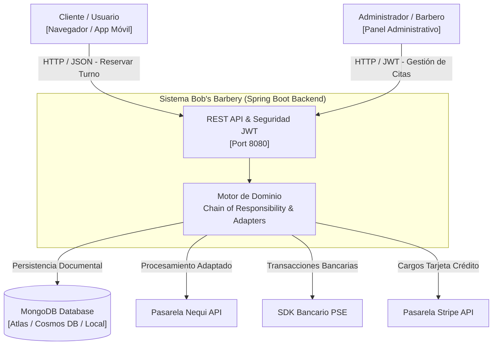

# 01 — Contexto y Alcance del Sistema: Bob's Barbery

## 1. Identificación del Proyecto
- **Proyecto:** Bob's Barbery — Sistema de Gestión de Turnos y Pagos Normalizados
- **Asignatura:** Desarrollo de Operaciones de Software (DOSW / DOWS)
- **Periodo Académico:** 2026-01
- **Estudiante:** Juan Diego Gaitán Pérez
- **Institución:** Escuela Colombiana de Ingeniería Julio Garavito

---

## 2. Descripción del Problema y Necesidad del Negocio
La Barbería **Bob’s Barber** requería modernizar su modelo operativo mediante una plataforma digital centralizada y confiable para:
1. **Gestionar turnos en línea:** Evitar sobreventa y congestión de clientes mediante control estricto de aforo por franja horaria (máximo 3 clientes por hora).
2. **Asignación inteligente de barberos:** Emparejar automáticamente cada turno solicitado con un barbero calificado según la especialidad del servicio requerido y su horario laboral disponible.
3. **Normalización multicanal de pagos:** Integrar cuatro medios de pago heterogéneos e incompatibles (Nequi, PSE bancario, Stripe y Efectivo en caja) bajo un contrato interno unificado, aislando las particularidades de cada API externa.
4. **Validación secuencial estricta:** Garantizar que ninguna cita sea confirmada sin superar ordenadamente una cadena de 5 validaciones de negocio.

---

## 3. Catálogo de Servicios y Precios Oficiales

| Código | Servicio | Precio (COP) | Especialidad Requerida |
| :--- | :--- | :--- | :--- |
| **SER-001** | Corte clásico | $25.000 | `CORTE` |
| **SER-002** | Corte + barba | $38.000 | `CORTE_BARBA` |
| **SER-003** | Diseño de cejas | $15.000 | `CEJAS` |
| **SER-004** | Afeitado con navaja | $20.000 | `BARBA` |
| **SER-005** | Tratamiento capilar | $45.000 | `CAPILAR` |

---

## 4. Equipo de Barberos y Disponibilidad Laboral

| Barbero | Especialidades | Días de Atención | Horario Laboral (24h) |
| :--- | :--- | :--- | :--- |
| **Miguel** | `CORTE`, `CORTE_BARBA` | Lunes a Jueves | 10:00 AM – 5:00 PM (10 – 17) |
| **Laura** | `CAPILAR`, `CEJAS` | Lunes a Viernes | 10:00 AM – 5:00 PM (10 – 17) |
| **Andres** | `CORTE`, `BARBA` | Martes, Jueves, Sábados y Domingos | 10:00 AM – 2:00 PM (10 – 14) |

---

## 5. Continuidad entre Tercio 1 y Tercio 2

| Dimensión | Tercio 1 (Parcial 1) | Tercio 2 (Parcial 2 — Evolución Actual) |
| :--- | :--- | :--- |
| **Arquitectura** | Ejecución en consola monolítica vía `Main.java` | API REST Spring Boot 3 desacoplada por capas (MVC) |
| **Patrón Comportamiento** | `Chain of Responsibility` en memoria | `Chain of Responsibility` desacoplado, inyectable y extensible |
| **Patrón Estructural** | `Adapter` para 4 pasarelas de pago | `Adapter` con fábrica extensible (`PaymentAdapterFactory`), DTOs y persistencia |
| **Persistencia** | Sin persistencia (datos volátiles en memoria) | MongoDB Documental reactivo (`turnos`, `usuarios`, `servicios`, `barberos`) |
| **Seguridad** | Sin autenticación | Spring Security 6 + JJWT Stateless + Roles (`ROLE_USER`, `ROLE_ADMIN`) |
| **Infraestructura** | Ejecución local simple | Docker multietapa, Docker Compose, CI/CD GitHub Actions y Azure App Service |
| **Documentación API** | Ninguna | OpenAPI 3.0 interactivo con Swagger UI y autorización Bearer |

---

## 6. Diagrama de Contexto del Sistema (C4 - Nivel 1)

