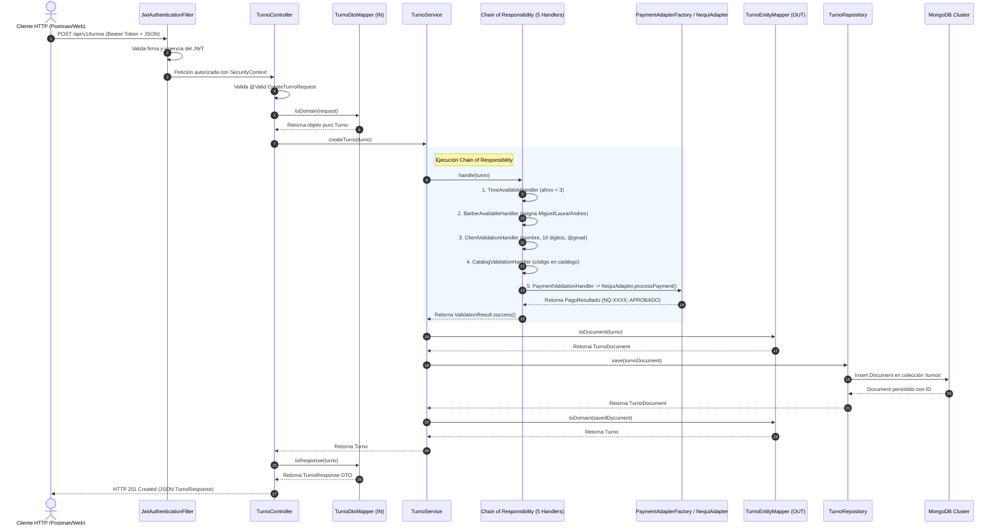

# 03 — Arquitectura del Backend y Modelo MVC Desacoplado

## 1. Principio Rector: Desacoplamiento Estricto por Capas

El backend adopta una arquitectura multicapa (Layered Architecture) adaptada al diseño de APIs REST modernas sobre Spring Boot 3 y Java 21.

### Reglas Arquitectónicas Invariables:
1. **El Controller NUNCA ve una Entidad/Documento de MongoDB:** Solo interactúa con DTOs de entrada y salida y delega en el Mapper IN (`controller.mappers`) para hablar con el Dominio.
2. **El Service NUNCA ve un DTO:** La lógica de negocio opera únicamente sobre modelos de dominio puros (`core.models`).
3. **El Repositorio NUNCA contiene lógica de negocio:** Se encarga exclusivamente de la persistencia y consulta sobre documentos MongoDB (`persistence.entities`).
4. **Doble Capa de Mappers:**
   - **Mapper IN (`controller/mappers`):** DTO ↔ Dominio.
   - **Mapper OUT (`persistence/mappers`):** Dominio ↔ Document (MongoDB).

---

## 2. Mapa de Paquetes y Responsabilidades

```text
edu.dosw.parcial/
│
├── controller/                               # CAPA DE PRESENTACIÓN / CONTROLADOR
│   ├── dtos/
│   │   ├── request/                          # DTOs de entrada validados con Jakarta Validation
│   │   └── response/                         # DTOs de respuesta serializables a JSON
│   ├── mappers/                              # MAPPER IN: RequestDTO -> Dominio, Dominio -> ResponseDTO
│   ├── handlers/                             # GlobalExceptionHandler (@RestControllerAdvice)
│   ├── TurnoController.java                  # Endpoints de turnos
│   ├── AuthController.java                   # Endpoints de autenticación
│   ├── CatalogController.java                # Endpoints de consulta de catálogo
│   └── HealthController.java                 # Health check endpoint
│
├── core/                                     # CAPA DE DOMINIO Y LÓGICA DE NEGOCIO
│   ├── models/                               # Entidades puras de negocio (POJOs independientes de DB)
│   │   ├── Cliente.java, Servicio.java, Barbero.java, Turno.java, Usuario.java, PagoResultado.java
│   │   └── Excepciones de negocio (TurnoValidationException, ResourceNotFoundException)
│   ├── services/                             # Servicios de aplicación y casos de uso
│   │   ├── TurnoService.java, AuthService.java, CatalogService.java
│   │   ├── BarberRegistry.java, ServiceCatalog.java
│   │   └── adapters/                         # PATRÓN ADAPTER: Nequi, PSE, Stripe, Efectivo + Factory
│   ├── validators/                           # PATRÓN CHAIN OF RESPONSIBILITY: 5 Manejadores
│   │   ├── ValidationHandler.java, TimeAvailableHandler.java, BarberAvailableHandler.java,
│   │   │   ClientValidationHandler.java, CatalogValidationHandler.java, PaymentValidationHandler.java,
│   │   │   ValidationChainFactory.java
│   └── utils/                                # Clases de utilidad técnica (TimeSlotUtil)
│
├── persistence/                              # CAPA DE ACCESO A DATOS (MONGODB)
│   ├── entities/                             # Clases @Document de MongoDB (TurnoDocument, UserDocument, etc.)
│   ├── repositories/                         # Interfaces que extienden de MongoRepository
│   │   ├── TurnoRepository.java, UserRepository.java, ServiceDocumentRepository.java, ...
│   └── mappers/                              # MAPPER OUT: Dominio <-> Document MongoDB
│
├── config/                                   # INFRAESTRUCTURA Y CONFIGURACIÓN TRANSVERSAL
│   ├── SecurityConfig.java                   # Configuración perimetral de Spring Security
│   ├── JwtService.java                       # Firma y validación de tokens JJWT
│   ├── JwtAuthenticationFilter.java          # Filtro de cabecera Authorization Bearer
│   ├── CustomUserDetailsService.java         # Carga de credenciales y roles
│   ├── SwaggerConfig.java                    # Configuración OpenAPI 3.0 con soporte Bearer
│   └── DataInitializer.java                  # Inicialización y sembrado de datos en MongoDB
│
└── main/                                     # PUNTO DE ENTRADA DE LA APLICACIÓN
    └── ParcialApplication.java               # @SpringBootApplication con escaneo base
```

---

## 3. Diagrama de Secuencia: Flujo de una Solicitud `POST /api/v1/turnos`


