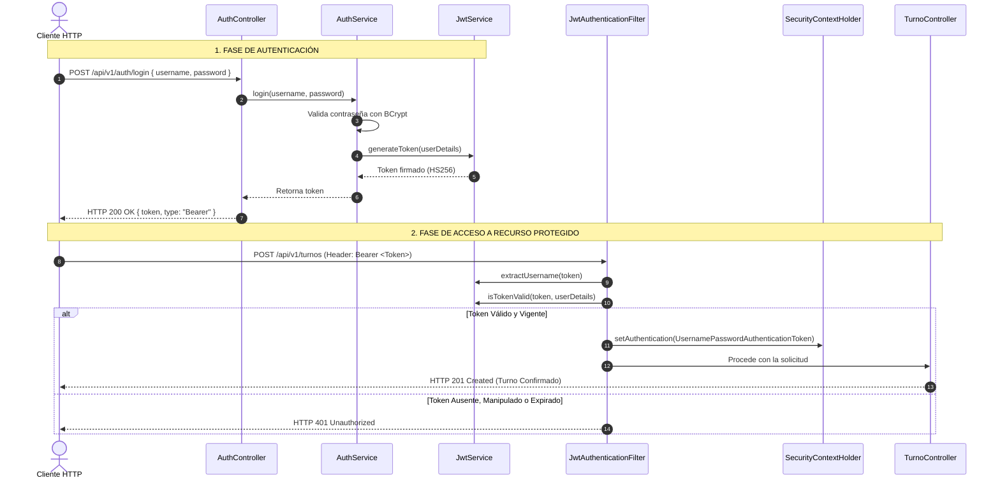

# 06 — Seguridad Perimetral, Spring Security y JWT

## 1. Arquitectura de Seguridad Implementada

La aplicación utiliza **Spring Security 6** en conjunto con la biblioteca estándar **JJWT (io.jsonwebtoken 0.12.3)** bajo un modelo de arquitectura sin estado (**Stateless Session Management**).

### Principios Fundamentales:
1. **Sin sesiones de servidor:** No se crean objetos `HttpSession` ni cookies de sesión en Tomcat. Cada solicitud HTTP es completamente independiente y debe portar sus credenciales en el encabezado.
2. **Criptografía robusta:** La firma de los tokens se realiza mediante el algoritmo simétrico **HMAC-SHA256 (`HS256`)**. La clave secreta configurada (`JWT_SECRET`) se valida para garantizar una longitud de clave de al menos 256 bits (32 bytes). Si se proporciona una cadena alfanumérica, se deriva su digest SHA-256 de forma determinista para evitar excepciones de longitud en JJWT.
3. **Contraseñas cifradas:** Las contraseñas de los usuarios nunca se guardan en texto claro; se procesan con `BCryptPasswordEncoder` con factor de coste estándar (10 rondas de hashing salteado).

---

## 2. Componentes de Seguridad en el Código

| Clase | Paquete | Responsabilidad |
| :--- | :--- | :--- |
| `SecurityConfig` | `config` | Define la cadena de filtros HTTP (`SecurityFilterChain`), desactiva CSRF/CORS innecesarios para API REST y establece las reglas de autorización por ruta. |
| `JwtAuthenticationFilter` | `config` | Filtro `OncePerRequestFilter` que intercepta cada petición, extrae la cabecera `Authorization: Bearer <token>`, valida su firma y establece el `SecurityContextHolder`. |
| `JwtService` | `config` | Encapsula la generación de tokens con claims (`subject`, `role`, `issuedAt`, `expiration`) y la validación de expiración. |
| `CustomUserDetailsService` | `config` | Implementa `UserDetailsService` cargando el usuario desde el repositorio de MongoDB `UserRepository`. |

---

## 3. Matriz de Autorización por Endpoints

```text
/api/v1/health          --> permitAll() (Monitoreo y health checks de Azure)
/api/v1/auth/**         --> permitAll() (Registro e Inicio de Sesión)
/api/v1/catalog/**      --> permitAll() (Consulta pública de servicios y barberos)
/swagger-ui/**          --> permitAll() (Documentación interactiva)
/v3/api-docs/**         --> permitAll() (Especificación OpenAPI en JSON)
/api/v1/turnos/**       --> authenticated() (Creación y consulta de turnos)
Cualquier otra ruta     --> authenticated()
```

---

## 4. Flujo de Autenticación y Validación



---

## 5. Cómo Probar la Seguridad desde Swagger UI o cURL

### Paso 1: Obtener el Token
```bash
curl -X POST http://localhost:8080/api/v1/auth/login \
  -H "Content-Type: application/json" \
  -d '{"username":"admin","password":"admin123"}'
```

### Paso 2: Invocar un Endpoint Protegido con el Token
```bash
curl -X GET http://localhost:8080/api/v1/turnos \
  -H "Authorization: Bearer <TOKEN_OBTENIDO>"
```

### Paso 3: Verificar Bloqueo sin Token
```bash
curl -X GET http://localhost:8080/api/v1/turnos
# Retorna HTTP 403 Forbidden o 401 Unauthorized según la configuración
```
