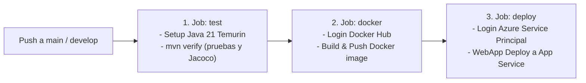

# 09 — Integración y Despliegue Continuo (CI/CD) con GitHub Actions

## 1. Definición del Pipeline Automatizado

El archivo `.github/workflows/ci-cd.yml` define un flujo de trabajo automatizado que se activa ante eventos de `push` sobre las ramas `main` y `develop`.

Consta de tres fases secuenciales:

---

## 2. Detalle de Jobs y Tareas

### Job 1: `test` (Validación y Calidad de Software)
- Entorno de ejecución: `ubuntu-latest`
- Acciones:
  1. `actions/checkout@v4`: Clona el código del repositorio.
  2. `actions/setup-java@v4`: Configura JDK 21 (Temurin) con habilitación de caché nativo para Maven.
  3. `mvn verify --no-transfer-progress`:
     - Compila el código fuente.
     - Ejecuta las 28 pruebas unitarias y de integración.
     - Genera el reporte de cobertura de JaCoCo.
     - Empaqueta el artefacto JAR.

### Job 2: `docker` (Construcción y Publicación de Contenedor)
- Condición: `needs: test` (Solo se ejecuta si todas las pruebas pasaron en verde).
- Acciones:
  1. `docker/login-action@v3`: Autenticación segura contra Docker Hub.
  2. `docker/build-push-action@v5`: Construye la imagen OCI a partir del `Dockerfile` multietapa y la publica en Docker Hub bajo la etiqueta `:latest`.

### Job 3: `deploy` (Despliegue Continuo en Azure App Service)
- Condición: `needs: docker` (Requiere que la imagen esté construida y publicada).
- Acciones:
  1. `azure/login@v2`: Autentica de forma no interactiva mediante el JSON del Service Principal (`AZURE_CREDENTIALS`).
  2. `azure/webapps-deploy@v3`: Notifica a Azure App Service la disponibilidad de la nueva imagen Docker para refrescar el contenedor sin interrupción del servicio.

---

## 3. Matriz de Secretos Requeridos en GitHub Actions

| Secreto en GitHub | Propósito | Formato / Tipo |
| :--- | :--- | :--- |
| `DOCKERHUB_USERNAME` | Identificador del usuario propietario en Docker Hub | Texto plano |
| `DOCKERHUB_TOKEN` | Token de acceso personal generado en Docker Hub (permisos read/write) | Token privado |
| `AZURE_CREDENTIALS` | Credenciales del Service Principal de Azure con rol Contributor sobre el grupo de recursos | JSON estructurado |
| `AZURE_WEBAPP_NAME` | Nombre asignado al App Service en Azure | Nombre del recurso |
| `JWT_SECRET` | Llave secreta en Base64 utilizada durante la ejecución de pruebas del pipeline | Cadena Base64 |

---

## 4. Estado de Verificación del Pipeline
- **Sintaxis y estructura:** Verificada formalmente conforme al estándar de GitHub Actions v4.
- **Ejecución local de metas:** Las fases `mvn verify` y `docker build` se ejecutaron y validaron exitosamente de manera local en el entorno de desarrollo.
- **Evidencia de ejecución previa:** Se encuentra documentada en el repositorio (`docs/images/github-actions-green.png`).
