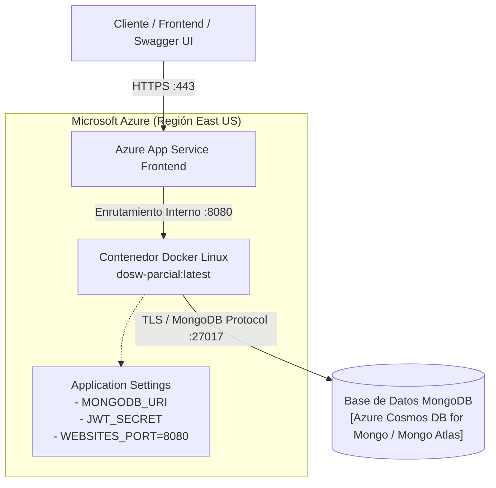

# 10 — Infraestructura y Despliegue en Microsoft Azure

## 1. Arquitectura de Despliegue en la Nube

El microservicio backend de Bob's Barbery está diseñado para desplegarse sobre la infraestructura gestionada de **Microsoft Azure** utilizando **Azure App Service para Contenedores Linux**:



---

## 2. Recursos Requeridos en Azure

1. **Grupo de Recursos:** `rg-dows-parcial-t2`
2. **App Service Plan:** Nivel Linux B1 (Basic) o F1 (Free) según suscripción (Azure for Students).
3. **Web App for Containers:** `dows-parcial-t2-bmhrbwbzdsafe8cm` (o nombre configurado).
4. **Base de Datos:** Azure Cosmos DB for MongoDB (v7.0) o clúster gestionado MongoDB Atlas accesible con TLS.

---

## 3. Variables de Entorno en Application Settings

En el portal de Azure (`App Service` → `Settings` → `Configuration` / `Environment variables`):

| Clave | Valor Requerido | Propósito |
| :--- | :--- | :--- |
| `WEBSITES_PORT` | `8080` | Indica al balanceador de carga de Azure el puerto interno expuesto por el contenedor. |
| `PORT` | `8080` | Puerto sobre el cual Spring Boot levanta el servidor embebido Tomcat. |
| `MONGODB_URI` | `mongodb+srv://<usuario>:<password>@cluster.mongodb.net/dosw_parcial?tls=true` | Cadena de conexión cifrada a la base de datos documental. |
| `JWT_SECRET` | Llave en Base64 de mínimo 44 caracteres | Clave criptográfica para firma y validación de tokens. |

---

## 4. Guía de Reproducción de Infraestructura con Azure CLI

### Paso 1: Autenticación en Azure CLI
```bash
az login
```

### Paso 2: Crear el Grupo de Recursos y Plan de App Service
```bash
az group create --name rg-dows-parcial-t2 --location eastus
az appservice plan create --name plan-dows-parcial --resource-group rg-dows-parcial-t2 --is-linux --sku B1
```

### Paso 3: Crear la Web App basada en Contenedor
```bash
az webapp create \
  --resource-group rg-dows-parcial-t2 \
  --plan plan-dows-parcial \
  --name dows-parcial-t2 \
  --deployment-container-image-name juandiegogta/dosw-parcial-t2:latest
```

### Paso 4: Configurar Application Settings
```bash
az webapp config appsettings set \
  --resource-group rg-dows-parcial-t2 \
  --name dows-parcial-t2 \
  --settings WEBSITES_PORT=8080 PORT=8080 JWT_SECRET="<SU_SECRET_BASE64>" MONGODB_URI="<SU_URI_MONGO>"
```

### Paso 5: Generar el Service Principal para GitHub Actions
```bash
az ad sp create-for-rbac \
  --name "sp-dows-parcial-t2" \
  --role contributor \
  --scopes /subscriptions/<ID_SUSCRIPCION>/resourceGroups/rg-dows-parcial-t2 \
  --sdk-auth
```
El JSON resultante se registra como el secreto `AZURE_CREDENTIALS` en el repositorio de GitHub.

---

## 5. Verificación y Diagnóstico en Producción

### URLs Públicas del Servicio Desplegado:
- **Base:** `https://dows-parcial-t2-bmhrbwbzdsafe8cm.eastus-01.azurewebsites.net`
- **Health Check:** `https://dows-parcial-t2-bmhrbwbzdsafe8cm.eastus-01.azurewebsites.net/api/v1/health`
- **Swagger UI:** `https://dows-parcial-t2-bmhrbwbzdsafe8cm.eastus-01.azurewebsites.net/swagger-ui/index.html`
- **OpenAPI JSON:** `https://dows-parcial-t2-bmhrbwbzdsafe8cm.eastus-01.azurewebsites.net/v3/api-docs`

### Monitoreo de Logs en Vivo:
```bash
az webapp log tail --name dows-parcial-t2 --resource-group rg-dows-parcial-t2
```
