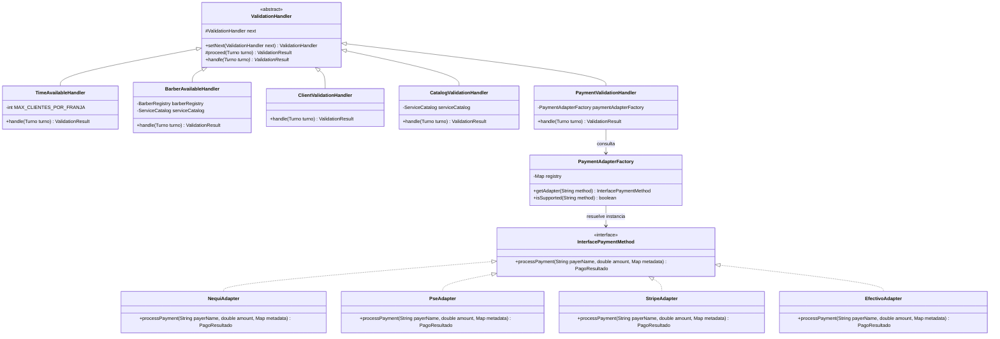

# 11 — Principios SOLID y Patrones de Diseño Aplicados

## 1. Aplicación Demostrada de Principios SOLID

El código de Bob's Barbery no menciona SOLID de manera superficial; cada principio es visible y verificable en su estructura:

### 1.1. Single Responsibility Principle (SRP)
- **Cada manejador de validación (`core.validators`):** `TimeAvailableHandler` solo evalúa aforo de la franja horaria. `BarberAvailableHandler` solo busca y asigna el barbero. `ClientValidationHandler` solo valida datos del cliente. Ninguno conoce cómo funciona la pasarela de pago ni la base de datos.
- **Separación de Mappers:** `TurnoDtoMapper` solo convierte DTOs HTTP ↔ Dominio. `TurnoEntityMapper` solo convierte Dominio ↔ Documento MongoDB.
- **Controladores (`controller`):** Únicamente gestionan códigos HTTP, serialización JSON y delegación; no contienen reglas de negocio ni consultas directas a MongoDB.

### 1.2. Open/Closed Principle (OCP)
- **Nuevas validaciones:** Si la barbería decide incorporar una validación adicional (ej. "Verificar cliente recurrente"), basta con crear una nueva clase `CustomerLoyaltyHandler extends ValidationHandler` y enlazarla en `ValidationChainFactory` sin modificar ni alterar los manejadores existentes.
- **Nuevas pasarelas de pago:** Si se integra una nueva pasarela (ej. PayPal), solo se crea `PayPalAdapter implements InterfacePaymentMethod` y se registra en `PaymentAdapterFactory.registerAdapter("PAYPAL", PayPalAdapter::new)`. El código central de pagos y la cadena permanecen cerrados a modificaciones.

### 1.3. Liskov Substitution Principle (LSP)
- Cualquier implementación de `InterfacePaymentMethod` (`NequiAdapter`, `PseAdapter`, `StripeAdapter`, `EfectivoAdapter`) puede ser sustituida en `PaymentValidationHandler` respetando el mismo contrato: recibe nombre, monto y metadatos, y produce un `PagoResultado` normalizado sin efectos colaterales.
- Cualquier `ValidationHandler` respeta el contrato `handle(Turno turno)` y delega mediante `proceed(turno)`.

### 1.4. Interface Segregation Principle (ISP)
- La interfaz `InterfacePaymentMethod` define un único método enfocado:
  ```java
  PagoResultado processPayment(String payerName, double amount, Map<String, String> metadata);
  ```
  No obliga a los adaptadores a implementar métodos que no necesitan (ej. cancelaciones, reembolsos o autenticación externa si no aplican).

### 1.5. Dependency Inversion Principle (DIP)
- Las capas de alto nivel (`TurnoService`) dependen de abstracciones: `ValidationChainFactory`, `InterfacePaymentMethod` y `TurnoRepository` (interfaz), no de implementaciones concretas de bajo nivel ni de SDKs externos.
- La inyección de dependencias de Spring desacopla completamente el ciclo de vida de los componentes.

---

## 2. Patrones de Diseño Aplicados

| Patrón | Tipo | Propósito en Bob's Barbery | Clases Clave |
| :--- | :--- | :--- | :--- |
| **Chain of Responsibility** | Comportamiento | Encadena las 5 validaciones obligatorias de un turno. Detiene el proceso ante el primer fallo y retorna la causa específica. | `ValidationHandler`, `TimeAvailableHandler`, `BarberAvailableHandler`, `ClientValidationHandler`, `CatalogValidationHandler`, `PaymentValidationHandler` |
| **Adapter** | Estructural | Convierte las firmas e interfaces incompatibles de Nequi, PSE, Stripe y Efectivo a un contrato interno normalizado `{ paymentId, status, message }`. | `InterfacePaymentMethod`, `NequiAdapter`, `PseAdapter`, `StripeAdapter`, `EfectivoAdapter` |
| **Factory / Registry** | Creacional | Instancia y resuelve dinámicamente los adaptadores de pago y construye la secuencia de la cadena de validación. | `PaymentAdapterFactory`, `ValidationChainFactory` |
| **Repository** | Arquitectural / Datos | Abstrae las operaciones CRUD y consultas documentales sobre MongoDB sin exponer detalles de bajo nivel. | `TurnoRepository`, `UserRepository`, `ServiceDocumentRepository` |
| **Builder** | Creacional | Construcción inmutable y fluida de DTOs, entidades de dominio y documentos sin constructores telescópicos. | Lombok `@Builder` en todas las clases de modelo |

---

## 3. Diagrama UML de Clases: Chain of Responsibility y Adapter


